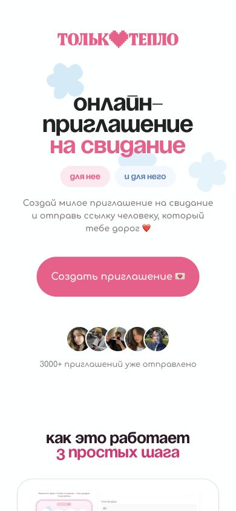
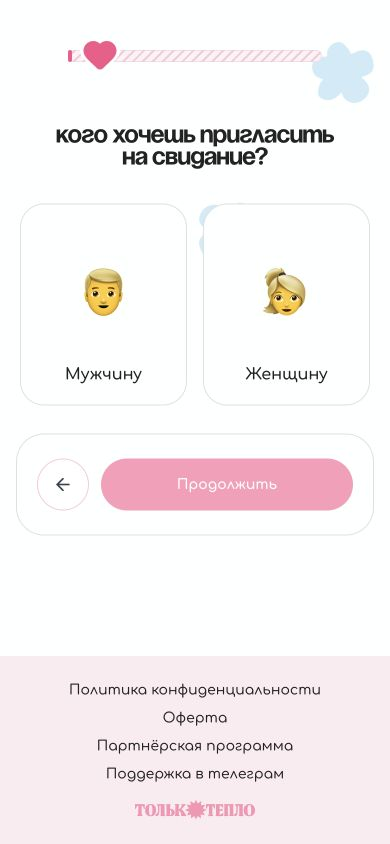
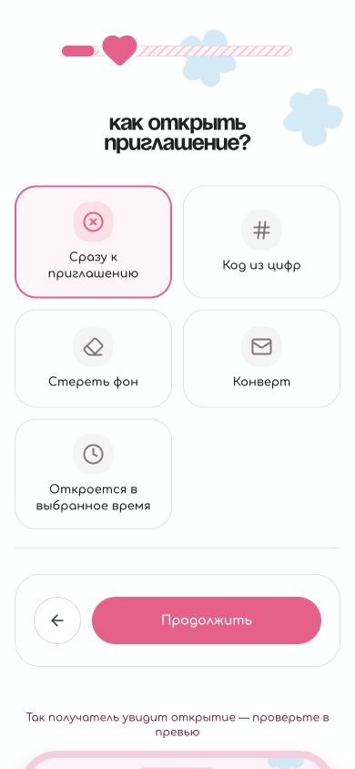
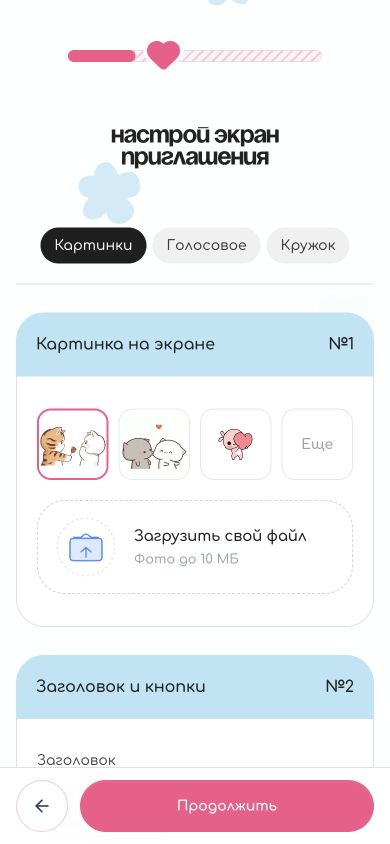
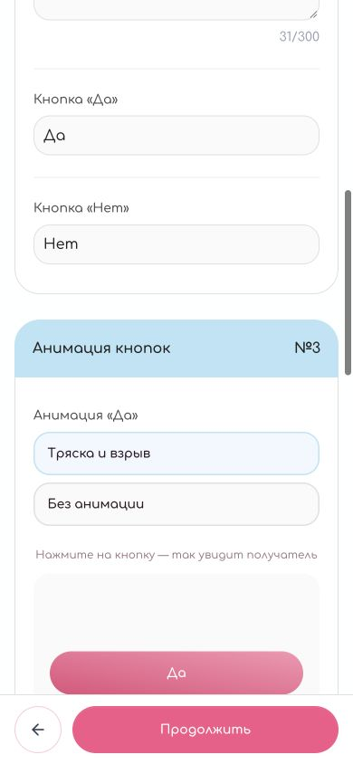
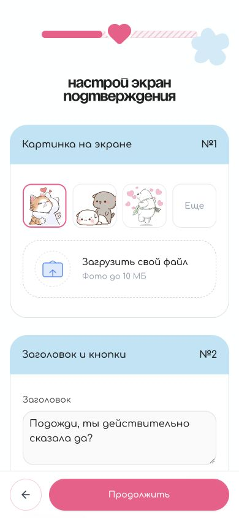
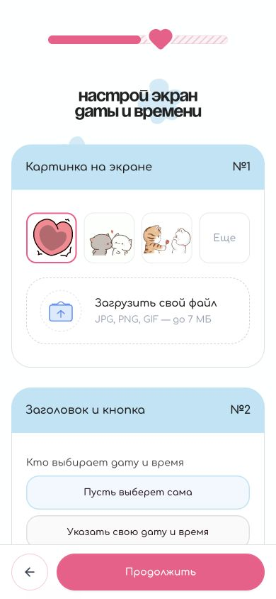
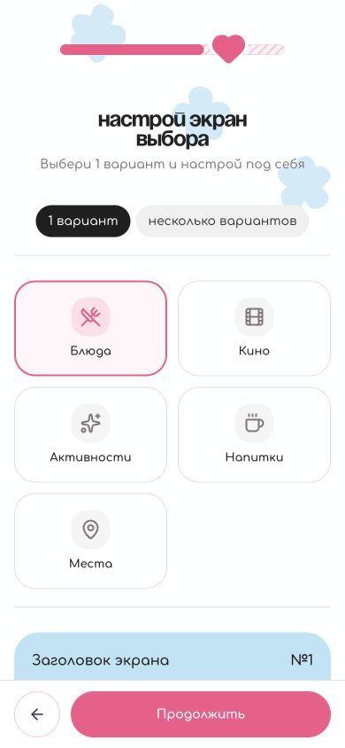
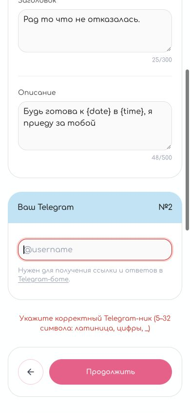

# Mybusik — аудит и направление продукта

Дата: 26 сентября 2026 года.

Mybusik помогает человеку порадовать любимого без повода: собрать небольшое личное послание, превратить его в тактильный интерактивный подарок и отправить ссылкой. Основная ценность — узнаваемые детали отношений и внимание автора. Маскот и анимации делают этот момент выразительным.

## Что подтверждено владельцем

- Название: «мой бусик», латиницей mybusik.
- Первая аудитория: пары; основной повод — порадовать любимого без повода.
- Движение: тактильное и игривое, мягкая пружина, наклейки, живой персонаж.
- Маскот получен и просмотрен 27 сентября: два PNG с образом, эмоциями, позами и ракурсами. Копии и разбор хранятся в `assets/mascot/`. Слоев или готовой модели в переданной папке нет.
- Исходная спецификация прочитана целиком. Цена 129 ₽, хранение 30 дней, состав мини-игр и технический стек — решения из документа, требующие дальнейшей проверки, а не повторно утвержденные требования.

## Границы работы

Проведен свежий аудит доступной части конструктора OnlyTeplo при размере окна 390 × 844. Скриншоты получены и проверены в текущем проходе. Исследован путь от первого экрана до обязательного Telegram на шаге 8 из 9. Не вводились чужие контакты и личные материалы; приглашение не опубликовано. Оплата, реальная доставка, получение ответа и работа после истечения ссылки не проверены.

У mybusik пока предоставлено описание, без работающего интерфейса. Поэтому ниже отдельно идут наблюдения по действующему конкуренту и экспертная оценка концепции. Оценка концепции не является результатом пользовательского тестирования. Статические скриншоты не доказывают плавность анимаций или полную доступность.

## Аудит OnlyTeplo

Источник интерфейса: https://onlyteplo.ru/meeting.

| Шаг | Состояние | Что наблюдалось | Вывод для mybusik |
|---|---|---|---|
| 1. Первый экран | Понятный вход, не хватает информации для решения | Хорошо видны обещание и основная кнопка. Цена и работающий пример не представлены в первом экране | Показать короткое демо результата, цену и срок доступа рядом с началом создания |
| 2. Получатель | Простой и понятный | Две крупные карточки; продолжение недоступно до выбора. Визуальный прогресс без числа, дерево сообщает «2 из 9» | Спрашивать имя или домашнее обращение; использовать нейтральные шаблоны, где это естественно |
| 3. Способ открытия | Выбор ясен, результат отдален | Пять вариантов; предпросмотр расположен ниже формы | Одна фирменная механика по умолчанию, смена темы — дополнительная возможность |
| 4. Экран приглашения | Функционально насыщенный | Готовые изображения, свои файлы, голосовое и кружок. Тексты и настройки анимаций на одном длинном шаге. Кнопка продолжения закреплена снизу | Сохранить готовые материалы и удобную навигацию; не заставлять автора выбирать параметры движения |
| 5. Подтверждение | Последовательный, но повторяет настройку | Еще один шаг с изображением, заголовком, подзаголовком и кнопкой | Для подарка без повода исключить отдельное редактирование служебного подтверждения |
| 6. Дата и время | Полезно для свидания | Можно поручить выбор получателю. На этом шаге указан лимит фото 7 МБ, на соседних — 10 МБ | Дату отношений сделать необязательной; правила загрузки сделать едиными |
| 7. Выбор | Богатая персонализация, неоднозначные подписи | Есть еда, кино, активности, напитки, места. Вкладки «1 вариант / несколько вариантов» и отдельный переключатель множественного выбора имеют похожие подписи | В первом сценарии предложить один понятный подарок; дополнительные варианты раскрывать по желанию |
| 8. Финал и Telegram | Выявлено препятствие | Пустой Telegram блокирует продолжение. Есть поясняющая ошибка, перевод фокуса в поле и alert в DOM | Ссылку отдавать в браузере; уведомления в Telegram подключать отдельно |
| 9. Следующий шаг и оплата | Не проверены | Переход требует корректного Telegram-ника | Не делать выводов о платежном экране и итоговой конверсии |

### Проверенные скриншоты

1. Первый экран: 
2. Получатель: 
3. Открытие: 
4. Редактор: 
4а. Параметры анимации: 
5. Подтверждение: 
6. Дата: 
7. Варианты: 
8. Ошибка Telegram: 

### Приоритетные наблюдения

**Высокий приоритет — поздняя обязательная зависимость от Telegram, шаг 8.** Человек уже прошел несколько форм, когда встречает требование контакта. Это потенциальное место отказа; фактическую долю отказов без аналитики установить нельзя.

**Средний приоритет — избыток решений в редакторе, шаги 3–7.** Предлагается выбирать не только содержание, но и множество деталей подачи. Для любителя персонализации это достоинство. Для быстрого подарка между делами стоит дать уже собранную композицию.

**Средний приоритет — обратная связь далеко от настройки, шаги 3–4.** На мобильном экране предпросмотр находится ниже формы. Для mybusik уместна заметная кнопка «Посмотреть как получатель» с возвратом к тому же месту редактирования.

**Низкий приоритет — несогласованные лимиты загрузки, шаги 4–6.** Изображение, подходящее одному экрану, может не подойти другому. У пользователя нет пояснения причины.

### Доступность

- Плюсы: видимые подписи полей, крупные карточки выбора, понятная основная кнопка; ошибка Telegram переводит фокус и имеет роль alert.
- На шагах 4–6 кнопки готовых картинок не имеют имени в просмотренном DOM. Для каждого варианта нужны понятные доступные названия. Работу с VoiceOver отдельно не проверяли.
- Светлые вспомогательные подписи на шагах 1, 4, 6 и 8 требуют численного замера контраста. По скриншотам нельзя присвоить соответствие WCAG.
- Предпросмотр и редактор могут иметь другой порядок чтения, чем визуальное размещение; нужна проверка клавиатурой и скринридером.
- Поддержка уменьшенного движения, масштабирование текста, реальная экранная клавиатура, iOS/Android и встроенные браузеры мессенджеров пока не проверены.

## Разбор идеи mybusik

### Обещание

Рабочая формулировка: «Маленький сюрприз для твоего бусика. Просто потому что люблю».

Задача автора: «Хочу показать, что думаю о человеке, и сделать это лично, даже если не умею красиво писать и у меня мало времени».

Задача получателя: быстро понять, от кого подарок, увидеть что-то про свои отношения, улыбнуться и при желании ответить. Получателю не следует проходить обязательный экзамен или выполнять задания, чтобы прочитать признание.

Слово «бусик» — сильная возможность для домашнего языка продукта. Обращение лучше делать редактируемым: некоторые пары используют другие слова. Пока не нужно переносить это название на все кнопки и технические статусы.

### Что сохранить

- Личные слова и совместные фотографии как основу подарка.
- Маскота как узнаваемого доставщика сюрприза.
- Одну выразительную механику раскрытия.
- Один подарок-обещание, который можно сохранить и использовать позднее.
- Необязательное голосовое: оно добавляет личное присутствие автора.
- Возможность сделать ответный подарок после того, как получатель закончил читать.

### Что пересмотреть

**Пять обязательных развлечений подряд.** Конверт, свайпы, квиз, частые нажатия, стирание и активация трех купонов увеличивают время и число препятствий. Предлагается короткий основной путь; дополнительные сцены автор включает сам. Это изменение исходного сценария, которое еще нужно согласовать.

**Квиз на память.** Неправильный ответ может восприниматься как проверка близости. Сделать его опциональным и доброжелательным; всегда разрешать продолжить. Правильный ответ не должен быть ключом к доступу к подарку.

**Тапы на скорость.** Предложение: одно нажатие или короткое удержание для объятия маскота с равнозначной кнопкой. Не требовать высокой скорости реакции. Любой жест должен иметь простой альтернативный способ.

**Обещание «за 90 секунд».** Сначала подтвердить его наблюдением: выбор фотографий, написание текста и голосовая запись занимают разное время. В быстром пути обязательны только обращение и несколько личных слов; медиа и дата отношений необязательны. Таймер запуска/сборки не является пользовательской ценностью сам по себе.

**Удаление через 30 дней.** У цифрового подарка есть ценность воспоминания, у купона — срок исполнения. Следует разделить срок размещения страницы, возможность сохранения и срок использования обещания. Решение пока открыто. Срок и ограничения нужно сообщать до оплаты.

**Цена 129 ₽.** Это гипотеза из спецификации. Преимущество продукта должно быть понятным и без сравнения цен. Решение о цене принимать после проверки желания платить и расчета поддержки, платежей и хранения.

### Предлагаемый основной путь автора

1. **Кому и что сказать.** Домашнее обращение, подпись автора, короткая фраза. Несколько заготовок для старта с возможностью редактирования.
2. **Добавить личное.** До трех фотографий, по желанию голос. Один купон из набора либо свой текст. Дополнительные квиз и дата спрятаны за «Добавить еще».
3. **Посмотреть и отправить.** Полный предпросмотр без оплаты; видны цена и срок. После подтвержденной оплаты — копирование ссылки, стандартное меню отправки и QR. Уведомления подключаются отдельно.

Для быстрого пути не требуются личный кабинет, запись аудио, точная дата знакомства или Telegram. В техническом проектировании нужно отдельно решить восстановление оплаченного подарка и доступ автора без аккаунта; здесь это не считается уже реализованным.

### Предлагаемый основной путь получателя

1. Маскот держит послание: «Тебе кое-что передали. От [имя]»; понятная кнопка открытия.
2. Раскрывается записка; если есть фото — легкая стопка воспоминаний с обычными кнопками навигации наряду со свайпом.
3. Личное послание и необязательный плеер; маскот успокаивается, чтобы дать прочитать и послушать.
4. Один сюрприз: снять наклейку или открыть подарок кнопкой. Показывается купон, который можно использовать позже.
5. Возможность ответить короткой реакцией, сохранить подарок и второстепенная ссылка на создание своего.

Реакция получателя должна отправляться после явного нажатия и подтверждаться состоянием «Отправлено». Просмотр страницы не равен согласию, активации купона или положительной реакции.

## Направление анимаций

Это проектное предложение на основе выбранного характера, не утверждение о единственном модном стиле. Визуальные цвета, материал маскота и форма объектов выбираются после получения его исходника.

Принцип: интерфейс ощущается как небольшой предмет в руках. Нажатие чуть сжимает элемент; отпущенная карточка мягко возвращается; наклейка отлипает; маскот замечает действие и отвечает короткой реакцией. В каждый момент есть один главный движущийся объект.

| Момент | Движение | Предварительный диапазон | Условие |
|---|---|---|---|
| Нажатие кнопки | Небольшое сжатие и возврат | 120–180 мс | Отклик начинается сразу |
| Смена шага | Общий элемент перемещается, новый текст проявляется | 250–400 мс | Без прокрутки всей страницы рывком |
| Карточка фотографии | Следует за пальцем, слегка поворачивается и возвращается пружиной | 250–450 мс после отпускания | Свайп необязателен |
| Раскрытие подарка | Маскот передает послание, снимается наклейка | 700–1100 мс | Можно пропустить, потом повторить |
| Успех | Маскот коротко обнимает или радуется | 450–800 мс | Один раз на событие |
| Чтение и аудио | Спокойная поза без отвлекающего движения | На время чтения | Никаких эффектов поверх текста |

Диапазоны — стартовые настройки для прототипа. Их необходимо оценить на реальном телефоне с готовыми ассетами; это не измерения сайта конкурента.

Не использовать одновременно бесконечное покачивание, параллакс, разлетающиеся сердца, крупное масштабирование и тряску текста. Звук включается осознанно. Для системной настройки уменьшенного движения — короткие появления и статичные состояния; все содержание доступно без жестов, звука и анимации.

Для UI подходит Motion; выбор режима reduced motion поддерживается официальным API: https://motion.dev/docs/react-use-reduced-motion. Для персонажа с реакциями на действия можно рассмотреть Rive; формат выбирается по исходнику. Плоская картинка не дает автоматически независимых движений глаз, рук и тела.

Контекст доступности: https://www.w3.org/WAI/WCAG22/Understanding/animation-from-interactions.html. Отключение несущественного движения — направление проектирования, а не заявление о пройденной сертификации.

## Маскот

Внешность зафиксирована по полученным референсам: кремовая шерсть, крупные уши с сиреневыми кончиками, розово-фиолетовые глаза, сердечко под глазом и светящееся сердце на хвосте. Рабочая роль — маленький посредник между двумя людьми: помогает собрать подарок, бережно приносит его и отступает во время личного сообщения.

Для первой версии достаточно шести состояний: спокойный; приветствует; держит подарок; удивляется; обнимает; мягко подсказывает при ошибке. Не нужна отдельная сложная анимация для каждого поля.

Нужно определить, как персонаж говорит: имеет ли собственное имя, использует ли слова, обращается ли на «ты», насколько допустимы ирония и детская манера. Пока принята только доброжелательная подача без давления.

## Материалы от владельца

| Приоритет | Материал | Достаточно сейчас | Зачем | Статус |
|---|---|---|---|---|
| Сейчас | Существующий маскот | PNG/JPG, скриншот эскиза или доступная ссылка | Понять силуэт, материал, эмоции, палитру | Получены и просмотрены два PNG 27 сентября |
| Сейчас | Характер маскота | 2–3 предложения: кто он, имя, что нельзя менять | Сохранить его идентичность | Не предоставлен |
| Сейчас | Примеры желаемого движения | 2–3 ссылки на сайты или короткие ролики; что конкретно нравится | Уточнить степень упругости, темп и тактильность | Есть словесное направление |
| Если есть | Логотип / написание бренда | SVG/PNG или текстовое указание | Согласовать «мой бусик» и mybusik | Известны оба названия |
| Если есть | Цвета, шрифты, запреты | Ссылки/названия/примеры; что не нравится | Не навязать чужую стилистику | Не предоставлены |
| Для прототипа | Пример наполнения | Псевдонимы, 1 послание, 1 купон; фото необязательны | Проверить верстку на реалистичной длине | Можно подготовить вымышленный набор |
| Позже | Исходник для анимации | Figma/AI/SVG с раздельными частями, PSD слоями, готовый .riv; для 3D — исходная модель | Получить качественные реакции персонажа | Формат неизвестен |
| Позже | Звуки и голос | Если уже есть фирменные материалы | Дополнительная выразительность | Не требуется для начала |

Для старта не нужно заказывать весь набор эмоций, приносить реальные личные фото или записывать голос. Сначала проверяем маскота и стиль; после выбора направления составляем точное задание на недостающие позы и анимацию.

## Проверка перед разработкой полной версии

На небольшом первом качественном тесте попросить 5–7 представителей аудитории собрать подарок без подсказок, затем показать результат нескольким получателям. Это разведочный тест, не статистическое доказательство спроса.

Проверить: понятно ли обещание за несколько секунд; хватает ли шаблонов для личного текста; где автор сомневается; замечает ли цену; хочет ли получатель досмотреть; не мешает ли маскот словам; понятен ли срок жизни; нужен ли купон позже. Измерять время сборки и причины отказа, а не назначать заранее желаемую конверсию.

События для будущей аналитики: начало сборки, готовность содержимого, предпросмотр, начало оплаты, подтвержденная оплата, копирование ссылки, открытие, достижение послания, открытие подарка, явная реакция, начало ответного подарка. Не передавать в аналитику содержание личных сообщений, фотографий и аудио.

## Следующее решение

27 сентября подготовлены три статичных визуальных направления с полученным персонажем. Порядок соответствует фактическому показу изображений в диалоге: 1 — `concepts/01-soft-letter.png`, 2 — `concepts/02-sticker-studio.png`, 3 — `concepts/03-small-light.png`. Выбор пока не сделан. После выбора перейти к интерактивному прототипу, чтобы проверить ощущение пружины, раскрытия и реакции на настоящем экране. Изображения не демонстрируют работающую анимацию.
